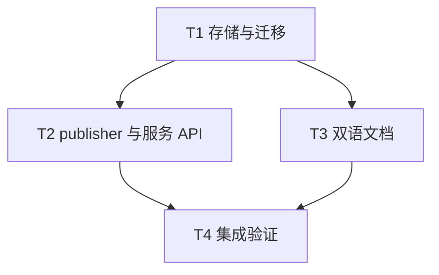

# rs-task 通知 outbox 恢复实施计划

> 历史记录：主要设计已于 schema v7 实施，复选框是原计划快照；后续保留契约见[本设计](design-20261015T225508405Z-e5fffbbc.md)。

**状态：** 已实施；本文复选框保留原计划快照。

> 面向下一位执行者：按下列依赖顺序实施，使用复选框记录结果。本文只规划工作；本轮未改实现。不得因本计划自行执行 `git add`、`git commit` 或 `git push`。

**目标：** 为失败的 outbox 头部提供可定位、可审计、显式隔离的恢复路径，并纠正中英文通知可靠性说明。

**依据：** [设计文档](design-20261013T100252764Z-2c014304.md)。

**技术栈：** Rust 2024、Tokio、rusqlite、SQLite `PRAGMA user_version`、`qubit-event-bus`。

**工作位置：** 当前 `rs-task` 仓库；不创建 Paseo workspace。设计和本计划保留在用户指定的 `doc` 路径。

## 全局约束

- 默认仍按 `(created_at_ms, task_id, state_version)` 顺序发布；任何失败均不自动丢弃。
- 隔离必须经操作员显式调用，并在持有 owner 的单个 SQLite 事务中完成归档和删除。
- 只允许隔离可读取键列且仍为当前失败头部的记录；身份变化返回冲突。
- 归档保存原始事件、时间、原因和最后错误；终态任务清理不删除归档。
- typed schema 升到 v7，支持新库及 v4/v5/v6 原位事务迁移；旧 UUID schema 继续拒绝。
- 现有 `NotificationStats` 的计数含义保持不变；新诊断值为进程内快照。
- `Accepted` 仅表示 provider 接纳，不保证消费者至少一次收到通知。
- 不修改与本设计无关的源码、脚本或文档；不在本计划内调整 crate 版本。

## 文件职责

| 文件 | 计划变更 |
| --- | --- |
| `src/store/sqlite_task_store/internal/schema.rs` | v7 初始化、迁移与归档表校验。 |
| `src/store/task_store.rs`、`src/store/sqlite_task_store.rs` | 带默认能力错误的隔离契约与 SQLite 原子实现。 |
| `src/service/task_event_publisher/internal/publisher_state.rs`、`src/service/task_event_publisher.rs` | 失败头部快照、控制命令、串行隔离与唤醒。 |
| `src/service/typed_task_execution_service.rs`、`src/service/mod.rs`、新建 `src/service/notification_failure.rs` | 公开诊断和显式隔离入口。 |
| `tests/task_notification_outbox_tests.rs`、`tests/publisher_tests/mod.rs` | 迁移、存储原子性及完整发布恢复回归。 |
| `README.md`、`README.zh_CN.md`、`doc/task_execution_service_design.en.md`、`doc/task_execution_service_design.md`、`doc/user-guide.md`、`doc/user-guide.zh_CN.md`、`doc/migration.md`、`doc/migration.zh_CN.md` | 双语可靠性边界及操作说明。 |

## 调度图

| 任务 | 前置任务 | 最小解锁产物 | 写入集合 | 本地验证 | 集成验证归属 | 审查时机 |
| --- | --- | --- | --- | --- | --- | --- |
| T1 存储与迁移 | 无 | v7 schema 和原子隔离 store 方法可编译 | `schema.rs`、`task_store.rs`、`sqlite_task_store.rs`、`tests/task_notification_outbox_tests.rs` | `cargo test --locked --features sqlite --test task_notification_outbox_tests` | T4 | 立即审查 |
| T2 publisher 与服务 API | T1 | 失败头部诊断和隔离命令可用 | `publisher_state.rs`、`task_event_publisher.rs`、`typed_task_execution_service.rs`、`service/mod.rs`、`notification_failure.rs`、`tests/publisher_tests/mod.rs` | `cargo test --locked --all-features --lib task_event_publisher` 及 `cargo test --locked --all-features --test task_notification_outbox_tests publisher_tests::` | T4 | 立即审查 |
| T3 双语文档 | T1 | v7 契约确定；文档可独立审阅 | 本文“文件职责”表所列 8 份 README/doc 文件 | 检查链接、术语和中英文逐段对应 | T4 | 批量审查；可与 T2 并行 |
| T4 集成验证 | T2、T3 | 实现和文档齐备 | 仅修复集成验证直接揭示的相关文件 | 全量测试、rustdoc、现有 CI 检查 | T4 | 立即审查 |

T2 与 T3 在 T1 可用后属于同一并行批次；其写入集合不重叠。所有 Cargo 命令共享 target 资源组，实际并行执行时须为任务分别设置 `CARGO_TARGET_DIR`，或串行运行重型命令。全量测试、rustdoc 和 CI 检查只由 T4 运行。

## 任务拓扑依赖图

### T1：存储与迁移

- [ ] 在 `tests/task_notification_outbox_tests.rs` 添加失败回归：v6 库带两条 outbox 记录升级后均保留；v4/v5 迁移及 v7 重开保留任务行；错误期望身份和非头部隔离返回 `StoreError::Conflict`；无 owner 返回 `OwnerConflict`；注入归档写入失败时原行仍在；成功隔离后归档内容逐字段等于原行，终态任务清理不删归档。
- [ ] 运行 `cargo test --locked --features sqlite --test task_notification_outbox_tests`，确认新增断言先失败于缺少 v7 表或方法。
- [ ] 在 `schema.rs` 将版本常量改为 7；把 v4→v5、v5→v6、v6→v7 迁移拆成明确条件分支，避免 v6 库重复执行 `CREATE TABLE task_event_outbox`。在同一事务创建 `task_event_outbox_quarantine` 并验证列、主键和必需索引；确保新库、v4/v5/v6 和 v7 重开的路径都经过验证。
- [ ] 在 `TaskStore` 增加默认返回 `UnsupportedCapability` 的 `quarantine_event_outbox_head`。约定参数为期望 `TaskId`、版本、事件 ID、非空原因和最后错误；SQLite 实现检查 owner，在一个事务内以排序键读取最老行，精确比较三项身份，原样归档后删除一行并提交；`reason` 的去空白与 4096 字节限制在 service 层检查，store 层也防止空值和超限绕过。
- [ ] 运行本任务的 focused 测试；确认升级、冲突、原子回滚及归档保留断言通过，并检查 `git diff --check`。

### T2：publisher 与服务 API

- [ ] 先在 `tests/publisher_tests/mod.rs` 添加完整回归：将最老事件的 `event_json` 改为无效 JSON、保留第二条有效事件；验证失败快照指向第一条且第二条未发布；调用隔离后第一条出现在归档、第二条被正常发布。再覆盖 provider 暂时失败时默认重试、错误身份冲突、发布成功与隔离竞态、等待者取消、关闭期间命令处理。必要时在 `publisher_state.rs` 的单元测试中放置精确的 worker 时序测试。
- [ ] 运行新增 focused 测试，确认其按预期失败于缺少诊断或隔离入口。
- [ ] 新建 `NotificationFailure`，字段固定为 `task_id`、`state_version`、`event_id`、`error`，在 `service/mod.rs` 导出；在 `TaskExecutionService` 增加 `notification_failure()` 和设计文档指定的 `quarantine_failed_notification(...)`。对未启用 publisher、关停、原因无效、身份变化分别返回明确错误，避免触发全服务故障锁存。
- [ ] 在 publisher 内增加有界控制队列及一次性响应通道。失败时记录当前头部身份与错误；worker 在发布尝试之间处理隔离命令，检查仍为失败头部后调用 T1 的 store 方法，提交后清空诊断并立即继续；普通通知不能打断失败退避。成功发布或头部改变时清空过期快照，worker 退出时回复所有未完成命令。确保取消调用方等待不取消已接收命令。
- [ ] 运行 `cargo test --locked --all-features --lib task_event_publisher` 和 `cargo test --locked --all-features --test task_notification_outbox_tests publisher_tests::`；`publisher_tests` 是该 integration test 内的模块，并非独立 test target。检查公开 Rustdoc 对隔离造成通知缺口及竞争返回值的说明。

### T3：双语文档

- [ ] 在两份 README 和两份设计文档首次描述通知投递的位置写明：SQLite 原子 outbox、接纳前可重试且可能重复、`Accepted` 后删行、Redis 接纳后仍可能在持久化前丢失、消费者收取不受“至少一次”保证。保留与任务 handler 至少一次执行语义的区分。
- [ ] 在两份用户指南加入同序操作步骤：观察 backlog 和失败计数；读取 `notification_failure()`；检查任务权威状态与归档策略；传入精确身份及原因调用 `quarantine_failed_notification`；验证归档表和后续出队；按版本缺口刷新消费者状态。明确隔离会有意丢失一条通知、不能自动补发。
- [ ] 在两份当前迁移指南将 typed SQLite schema 更新为 v7，说明 v6→v7 原位迁移、归档表及自定义 `TaskStore` 默认能力错误；同时修正“至少一次通知送达”的无条件表述。历史 0.8 文档保持原样。
- [ ] 对照八份文件检查中英文段落含义、相对链接、API 名称和 schema 版本；运行 `git diff --check`。

### T4：集成验证

- [ ] 核对 T1、T2、T3 的接口名称、状态语义、schema 版本及测试期望一致；只修复直接相关的不一致。
- [ ] 运行 `cargo test --locked --no-default-features`，验证无 `event-bus` 构建不受影响。
- [ ] 运行 `cargo test --locked --all-features`；若 Redis 测试需要外部服务，按现有仓库配置提供服务并记录结果，不能把跳过项写成通过。
- [ ] 运行 `cargo doc --locked --all-features --no-deps`、`./.infra/bin/style-check.sh` 和 `./.infra/bin/ci-check.sh`；对项目既有格式化流程，先核对脚本会改动的范围，再按仓库规则执行。
- [ ] 检查 `rs-event-bus-redis/tests/fixtures/task_notifications` 对现有 API 的编译接入，核对最终 `git diff --check`、改动文件范围和测试输出；报告未运行的外部依赖测试与剩余风险。

## 验收映射

| 设计要求 | 任务 |
| --- | --- |
| 失败头部诊断、显式隔离、worker 串行化及竞态处理 | T2 |
| owner fence、精确头部比较、原子归档、schema v7 迁移 | T1 |
| 非自动跳过、默认重试、隔离后后续发布 | T2 |
| 双语可靠性边界、操作步骤与迁移说明 | T3 |
| 全 feature 组合、rustdoc、CI 与下游接入核对 | T4 |

实施完成的判据是：上述测试和门禁给出可核对的通过记录；故障注入证明坏头部可被定位与显式归档，且后续事件恢复；文档不再暗示消费者通知具有无条件至少一次送达保证。
