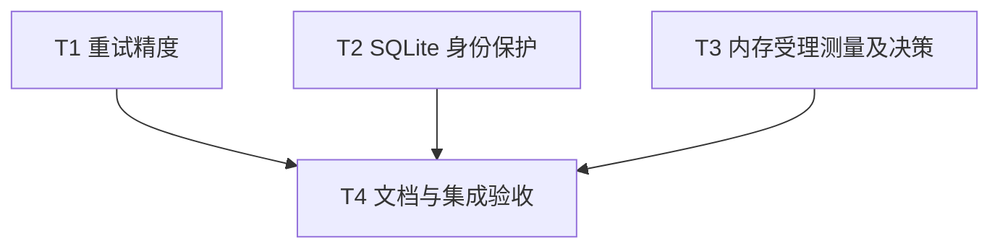

# rs-task 评审改进实施计划

> **面向智能体执行者：** 使用 executing-plans 逐项执行，各步骤使用复选框跟踪。此文件是下一阶段的实施计划，当前仅编写文档，并未执行其中命令。

**目标：** 完成 TASK-001、TASK-002，并以测量结果决定 TASK-003 的最小优化。

**架构：** 在现有 RetryPolicy、SQLite 受理事务和 MemoryTaskStore 内作局部修改；保留公开 API 与 schema v8。

**技术栈：** Rust 2024、Tokio、rusqlite、现有 Cargo 测试和基础设施脚本。

**项目：** `/data/working/qubit/rust-common/rs-task`。

**设计：** [配套设计](design-20261110T063716123Z-f6411961.md)。按用户要求文件保存在项目 doc，不使用临时方案目录。

## 范围及全局要求

采纳：TASK-001（精度）、TASK-002（身份防御）、TASK-003（先测量的优化机会）。明确排除或搁置：无。TASK-003 的实际收益未验证，接受核查不等于认定性能故障。

持续使用当前 Paseo workspace，不创建或打开新 Paseo workspace。实施前读取适用仓库规则，记录当前 dirty 状态，保留已有用户变更，不重置或覆盖；方案中的提交/推送策略以实施命令授权为准，当前文件不自行授权远端操作。最低 Rust 版本沿用 Cargo.toml 的 1.94，不新增依赖或 schema 迁移。

所有任务可按后续授权修改 Rust 源码、测试及必要配置。为解决验证失败及覆盖率不足，允许修复必要的已有基线问题；说明关联和证据，不降低检查门槛、不删除有效测试来规避失败。本阶段不运行下述实施命令，文档交付后本阶段结束。

## 调度图

T1、T2、T3 是同一可并行批次，写入集合互斥；不要求派发子 agent。默认当前会话执行；若后续明确授权并行工作，可按该批次调度。共享 Cargo target 资源组的重型命令串行，最终全量验证统一由 T4 执行。

| 任务 | 前置任务 | 最小解锁产物 | 写入集合（相对项目根） | 本地验证 | 集成验证归属 | 审查时机 |
| --- | --- | --- | --- | --- | --- | --- |
| T1 | 无 | 无外部接口依赖 | src/service/retry_policy.rs；src/service/typed_task_execution_service/internal/service_runner.rs；tests/service/retry_policy_tests.rs；tests/service/typed_task_execution_tests.rs | cargo test --test typed_service_tests retry；cargo test --lib retry | T4 | 立即审查 |
| T2 | 无 | 无外部接口依赖 | src/store/sqlite_task_store/internal/typed_store.rs；src/store/sqlite_task_store.rs；tests/store/task_notification_outbox_tests.rs；tests/task_store_contract_tests.rs | cargo test --features sqlite --test task_store_contract_tests；cargo test --all-features --test store_tests | T4 | 立即审查 |
| T3 | 无 | 无外部接口依赖 | Cargo.toml（仅 bench 声明）；benches/memory_accept.rs；src/store/memory_task_store.rs；tests/store/memory_tests.rs | cargo bench --bench memory_accept；cargo test --test store_tests memory | T4 | 批量审查 |
| T4 | T1、T2、T3 | 三项结果与 T3 测量决策 | src/service/typed_task_execution_service_builder.rs；src/store/task_store.rs；README.md；README.zh_CN.md；doc/typed-task-api.md；doc/typed-task-api.zh_CN.md；doc/user-guide.md；doc/user-guide.zh_CN.md；doc/task_execution_service_design.en.md；doc/task_execution_service_design.md；doc/migration.md；doc/migration.zh_CN.md；必要的验证修复文件 | 文档契约核对 | 本任务负责全量测试、CI、coverage、Rustdoc 和下游验证 | 立即审查 |

## 任务拓扑依赖图



## T1：毫秒量化保持正延迟

输入接口：现有 `RetryPolicy::delay_for_attempt(self, attempt: u32) -> Duration`。输出接口：新增 crate 私有 `delay_millis_for_attempt(self, attempt: u32) -> u64`，公开 API 不变。使用调度表中的文件与命令，交付后立即审查。

- [ ] 在 retry_policy.rs 单元测试中添加表驱动测试，输入和预期毫秒为 `(1ns,1)`、`(999999ns,1)`、`(1ms,1)`、`(1000001ns,2)`；同时断言原公开方法仍返回配置 Duration。
- [ ] 补充 attempt=0、指数增长到带小数毫秒上限、u32::MAX、Duration::MAX 饱和测试。运行 `cargo test --lib retry`，确认新增边界在旧转换规则下失败；测试不能仅复制转换公式，应列出固定预期。
- [ ] 在 RetryPolicy 实现私有转换，核心实现如下，并添加英文 Rustdoc：

```rust
pub(crate) fn delay_millis_for_attempt(self, attempt: u32) -> u64 {
    let delay = self.delay_for_attempt(attempt);
    let millis = delay.as_millis()
        + u128::from(delay.subsec_nanos() % 1_000_000 != 0);
    millis.min(u128::from(u64::MAX)) as u64
}
```

- [ ] 修改 service_runner 的期限生成，保留饱和加法：

```rust
now_ms().saturating_add(self.core.retry_policy.delay_millis_for_attempt(started.attempt))
```

- [ ] 在 typed_task_execution_tests.rs 复用现有 retry handler 和存储包装方式，记录 retry transition 的 deadline。采用受控存储拦截及时间边界断言验证正延迟，不依赖真实亚毫秒 sleep；允许用内部确定性时间参数测试期限计算并结合服务写入测试，不能只测 helper。
- [ ] 运行本地两条 focused 命令，确认已有零值拒绝、指数封顶、可重试/不可重试分支不回退。记录失败复现和最终结果。

## T2：SQLite 清理后拒绝重复身份

输入接口：现有 `accept_encoded` 事务及终态检查点表。输出接口：现有 DuplicateTask / DuplicateTaskId，身份错误不锁存服务。无需等待 T1/T3，按表交付后立即审查。

- [ ] 在 task_store_contract_tests.rs 添加 SQLite 专用回归：受理指定 ID、启动、终态、清理；再次以同 ID 不同请求受理，预期 DuplicateTask，且 get_encoded_task 返回 None，原 get_state_checkpoint 的状态与版本不变。运行 focused 命令确认旧实现错误受理。
- [ ] 添加关闭重开数据库后同样拒绝的测试；增加旧幂等键配新 ID 成功、保留任务相同幂等请求 created=false 的断言，避免误把幂等键和身份合并处理。
- [ ] 保持幂等检查在前，把现有 SELECT EXISTS 替换为设计指定双表 OR EXISTS，参数仍为 `id.to_padded_decimal()`；继续返回 StoreError::DuplicateTask。不要删除检查点或重置其版本。
- [ ] 在 task_notification_outbox_tests.rs 复用带 outbox 的清理夹具，比较拒绝前后 outbox 行数及原检查点；在 task_store_contract_tests.rs 增加服务注入受控 generator 的用例，碰撞拒绝后新合法 ID 仍成功，证明未锁存故障。
- [ ] 运行调度表的 SQLite 契约及全特性 store_tests，检查清理失败回滚、检查点保存、原幂等逻辑。同步相关 store Rustdoc，明确持久检查点也保留任务身份。

## T3：测量后决定内存快速路径

输入接口：TaskStore 的受理/状态迁移/清理 API；输出为基准报告、决策和条件成立时的局部优化。与 T1/T2 无写入依赖。

- [ ] 在 Cargo.toml 新增 `[[bench]] name = "memory_accept"`、`harness = false`；创建 benches/memory_accept.rs，无新依赖。按设计构造 0/256/4096/32768 终态历史、64 字节 payload 和 64MiB 预算。
- [ ] 实现固定批次、预热、至少五次重复及中位数/p95 输出；历史准备、状态迁移和清理不计入受理计时。每批最多 128 个未完成任务；每批后恢复历史规模，校验任务计数、请求唯一性与成功状态，防止测到错误路径。
- [ ] 运行 `cargo bench --bench memory_accept` 保存基线到仓库外报告目录，记录实际命令、环境和历史组数据。此步骤必须早于生产代码修改。
- [ ] 在 memory_tests.rs 核对并补齐预算充足、恰好满额、回收成功、不可回收拒绝且历史未变的契约测试。不要添加只断言内部扫描次数的测试。
- [ ] 尝试以下快速路径结构，原回收判断和驱逐内容保持在分支内部，不引入计数器：

```rust
let fits = state.retained_payload_bytes.checked_add(requested_bytes)
    .is_some_and(|total| total <= self.max_payload_bytes);
if !fits {
    // 执行现有 reclaimable_bytes 计算、可行性检查和驱逐循环。
}
```

- [ ] 运行 `cargo test --test store_tests memory`，随后在同环境重跑基准。比较大历史组改善和样本波动，以及空历史组回退情况。改善可辨认且小历史无可辨认回退则保留；否则撤销仅本任务的快速路径改动，保留基准及“不优化”的证据。不能用用户接受评审代替测量结果。
- [ ] 保存前后数据与决策，交 T4 汇总，不将噪声阈值写成 CI 的绝对时延门槛。

## T4：双语文档、下游与统一验收

输入：T1/T2 行为结果、T3 报告与是否优化决定。输出：一致的双语契约、实际验证证据和可交付改动。此任务负责所有昂贵的最终检查。

- [ ] 按调度表文档写入集合更新精度契约：向上量化到毫秒、最多增加不足 1ms、不等同于实际墙钟等待保证。更新身份契约：生成器跨重启唯一；SQLite 检查点保留期间拒绝复用 TaskId；MemoryTaskStore 不保留清理后身份；幂等键释放不等于身份释放。
- [ ] 双语迁移指南说明已有唯一生成器无需迁移，错误复用清理 ID 将收到 DuplicateTaskId；不宣称自动修复历史冲突。README 仅添加简短提示/指南链接；核对当前双语指南、当前设计、英文 Rustdoc 一致。
- [ ] 在当前 workspace 只读核对 `../rs-event-bus-redis/tests/fixtures/task_notifications/src/main.rs` 的计数器用途及依赖；运行 `cargo check --manifest-path ../rs-event-bus-redis/tests/fixtures/task_notifications/Cargo.toml` 验证消费 API。后续实施授权若不覆盖下游写入，先检查该命令是否会更改下游 lockfile，必要时使用 `--locked`；失败须说明，不能隐式更新下游。不要求下游重构。
- [ ] 读取项目实际验证配置，依次运行 `./.infra/bin/align-ci.sh`、`./.infra/bin/style-check.sh`、`cargo test`、`cargo test --all-features`、`cargo doc --all-features --no-deps`、`./.infra/bin/ci-check.sh`、`./.infra/bin/coverage.sh`；避免并发争用 target。如 CI 入口已包含同等完整检查，可引用实际日志去重，但不可省略未覆盖项。全特性测试需要的 Redis 按现有夹具准备。
- [ ] coverage 保持当前函数覆盖率 93% 或实施时配置/CI 的更严格要求；Rustdoc 链接告警、项目风格要求和平台门禁按现有规则处理。需要 Windows 环境的已有门禁在对应 CI 验证，不能把本机未运行标为通过。
- [ ] 对实际测试/CI/覆盖率失败进行定位，允许新增或修改必要测试及源码，包括已有基线问题，记录关联与修复范围；重新运行受影响 focused 检查和必要集成检查，不降低门槛。
- [ ] 自审最终 diff，保留用户未提交改动，确认未新增公共配置、未迁移 schema、没有无关重构。记录各命令退出码、报告位置、未运行项与原因，只有实际通过才能标为通过；提交/推送遵循后续实施命令，不从本计划推断授权。

## 完成检查表

- [ ] TASK-001 → T1：量化边界、实际期限、公开 API 保持；T4：双语精度说明。
- [ ] TASK-002 → T2：清理前后、重开、幂等键释放、通知无新增、服务不锁存；T4：调用方与迁移说明。
- [ ] TASK-003 → T3：基线、对照、决策、容量契约；T4：报告汇总，不夸大收益。
- [ ] T4：全量测试、CI、coverage、Rustdoc 与下游检查有实际证据，持续 workspace 限制得到遵守。
